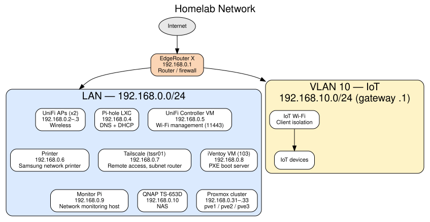

# Homelab

A Proxmox + Ceph cluster, self-hosted core services, and a learning lab.
Built for reliability where it matters and experimentation everywhere else:
core services stay boring, the playground stays separate.

It also doubles as the practice ground for my cert path (Linux+ → RHCE → CCNA).

## Network

LAN is `192.168.0.0/24`, with DNS and DHCP on a Pi-hole LXC.

Diagram source: [assets/topology.dot](assets/topology.dot) (Graphviz).

| Device | IP | Role |
| --- | --- | --- |
| EdgeRouter X | 192.168.0.1 | Router / firewall |
| UniFi APs (x2) | 192.168.0.2–.3 | Wireless |
| Pi-hole LXC | 192.168.0.4 | DNS + DHCP |
| UniFi Controller VM | 192.168.0.5 | Wi-Fi management (web UI on 11443) |
| Printer | 192.168.0.6 | Samsung network printer |
| Tailscale VM (tssr01) | 192.168.0.7 | Remote access, subnet router |
| iVentoy VM (VM 103) | 192.168.0.8 | PXE boot server |
| Monitor Pi | 192.168.0.9 | Network monitoring host |
| QNAP TS-653D | 192.168.0.10 | NAS |

### VLAN 10 — IoT

IoT devices live on their own VLAN, separate from the main LAN:

- **Subnet:** 192.168.10.0/24, gateway on the EdgeRouter X (.1)
- **Firewall:** IoT clients can reach Pi-hole for DNS; otherwise the VLAN
  is isolated from the main LAN.
- **Wireless:** a separate IoT SSID on the UniFi APs, with client isolation —
  wireless IoT clients can't reach each other or the main LAN.

## Compute — Proxmox cluster

Three nodes, Proxmox VE 9.2.20, in a cluster with shared Ceph storage
(one OSD per node) so guests live-migrate between nodes:

| Node | IP | Hardware |
| --- | --- | --- |
| pve1 | 192.168.0.31 | Ace Magician AM06PRO — Ryzen 7 5700U, 32 GB RAM |
| pve2 | 192.168.0.32 | Ace Magician AM06PRO — Ryzen 7 5700U, 32 GB RAM |
| pve3 | 192.168.0.33 | Ace Magician AM06PRO — Ryzen 7 5700U, 32 GB RAM |

Node upgrades are rolling, one node at a time, with pre-flight gates:
quorum, Ceph health, HA evacuation state, and survivor-node health
(corosync pressure and load) are all checked before any reboot.

## Storage

- **Ceph (pool `primary`)** — 3-node cluster, one OSD per Proxmox node;
  shared storage for all non-lab guests (Pi-hole, UniFi, iVentoy,
  netboot.xyz, Tailscale). Guests aren't pinned to a node — live
  migration moves them in seconds with no disk copy (proven Oct 2026:
  UniFi moved nodes with its browser session staying live).
- **QNAP TS-653D** — NAS for write-heavy storage.
- **Local storage** — node-local disks for the study-lab VMs only
  (200–203), which stay local by design.

## Power

CyberPower CP1000AVRLCDa UPS on USB, with a fresh 12 V 9 Ah SLA battery
(installed October 2026). All nodes are set to power back on automatically
after an outage.

## Raspberry Pi fleet

Four Raspberry Pi 4 (4 GB), each with a SATA SSD over USB:

- **192.168.0.9** — dedicated network monitor (all-FOSS monitoring stack,
  in progress).
- **Three more** — reserved for a 3-node k3s learning cluster (planned).

## Learning lab

An isolated study network (`10.20.0.0/24`) pinned to pve1, built for
CompTIA Linux+ study: Debian, Ubuntu, and Rocky VMs with their own DHCP/DNS,
reachable from the LAN via SSH ProxyJump — nothing to clean up on teardown.

## Scripts

- [pve-rolling-upgrade.sh](scripts/pve-rolling-upgrade.sh) — rolling
  Proxmox VE upgrade helper: one node at a time, with quorum, Ceph health,
  HA evacuation, and survivor-node health gates before any reboot.
  Dry-run by default; `--apply` asks for explicit YES. Tailored to this
  3-node PVE 9 + Ceph cluster — adapt `NODES` and `EXPECTED_PVE_MAJOR`
  before running it elsewhere.

## In progress / planned

- All-FOSS monitoring stack (Prometheus, Grafana, Alertmanager) on the
  monitor Pi.
- 3-node k3s learning cluster on the remaining Pi 4s.
- DNS redundancy (second resolver so Pi-hole isn't a single point of failure).
